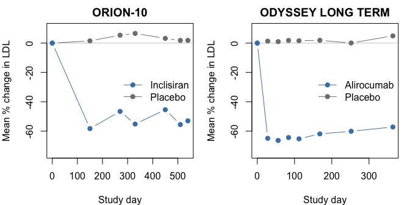

<!-- README.md is generated from README.Rmd. Please edit that file -->

# clinique

<!-- badges: start -->

<!-- badges: end -->

This package gives you data shaped like a real clinical trial, so you
can fit that trial’s own analysis to it. Each dataset is modeled on a
published trial and its statistical analysis plan: the same visits, the
same covariates, and effects that match the published results.

Every subject is made up. The data is not affiliated with or endorsed by
any trial’s sponsor.

## Installation

You can install the development version of clinique from
[GitHub](https://github.com/) with:

``` r
# install.packages("pak")
pak::pak("edgararuiz/clinique")
```

## Available studies

`simulate_ldl()` covers two trials of drugs that lower LDL cholesterol.
Both are analyzed with a mixed model for repeated measures (MMRM), but
each one teaches something different:

| `study` | Trial | Drug | Subjects | Design | What it teaches |
|----|----|----|----|----|----|
| `"orion10"` | ORION-10 | Inclisiran, twice a year | 1,561 | 1:1, 6 visits over 18 months | An effect that rises and falls with each dose |
| `"odyssey_lt"` | ODYSSEY LONG TERM | Alirocumab, every two weeks | 2,341 | 2:1, 7 visits over 1 year | Adjusting for randomization strata, and weighting means by them |

The difference in dosing shows in the data. Inclisiran’s effect is
strongest a few months after each dose and weaker just before the next.
Alirocumab’s stays flat:



## Example

Simulate ODYSSEY LONG TERM. Each row is one subject at one visit. The
last four columns are the randomization strata, which the trial’s
analysis plan adjusts for:

``` r
library(clinique)

set.seed(1)
ldl <- simulate_ldl(2341, study = "odyssey_lt")
head(ldl)
#> # A tibble: 6 × 14
#>   subject_id treatment   age sex   race  visit     day ldl_baseline   ldl
#>   <fct>      <fct>     <dbl> <fct> <fct> <ord>   <dbl>        <dbl> <dbl>
#> 1 001-0001   Placebo      62 Male  White Week 4     28         85.0  81.8
#> 2 001-0001   Placebo      62 Male  White Week 8     56         85.0  85.3
#> 3 001-0001   Placebo      62 Male  White Week 12    84         85.0  81.3
#> 4 001-0001   Placebo      62 Male  White Week 16   112         85.0  85.9
#> 5 001-0001   Placebo      62 Male  White Week 24   168         85.0  61.6
#> 6 001-0001   Placebo      62 Male  White Week 36   252         85.0  56.0
#> # ℹ 5 more variables: ldl_pct_change <dbl>, hefh <fct>, prior_mi_stroke <fct>,
#> #   statin_intensity <fct>, region <fct>
```

Fit the trial’s MMRM and compare the arms at Week 24, the primary
endpoint:

``` r
fit <- mmrm::mmrm(
  ldl_pct_change ~ treatment * visit +
    hefh * visit +
    prior_mi_stroke * visit +
    statin_intensity * visit +
    region * visit +
    ldl_baseline * visit +
    us(visit | subject_id),
  data = ldl,
  reml = TRUE,
  method = "Satterthwaite"
)

means <- emmeans::emmeans(fit, ~ treatment | visit, weights = "proportional")
#> mmrm() registered as emmeans extension
diffs <- summary(emmeans::contrast(means, "revpairwise"))
diffs[diffs$visit == "Week 24", ]
#>  contrast             visit   estimate   SE   df t.ratio p.value
#>  Alirocumab - Placebo Week 24    -64.2 1.19 2331 -53.949 <0.0001
#> 
#> Results are averaged over the levels of: hefh, prior_mi_stroke, statin_intensity, region
```

The trial reported a difference of -62% (95% CI -64 to -59).

## Learn more

Each study has an article that explains every number in the simulation,
where it came from, and what was assumed:

1.  ORION-10: `vignette("orion10", package = "clinique")`.
2.  ODYSSEY LONG TERM: `vignette("odyssey-lt", package = "clinique")`.
